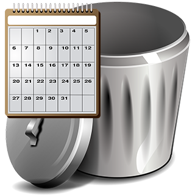
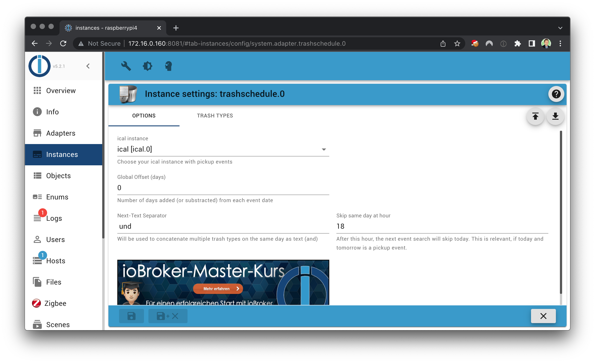
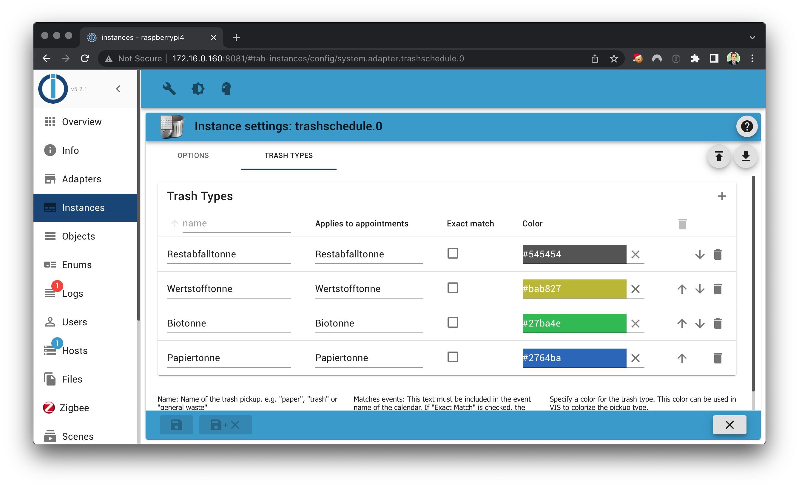
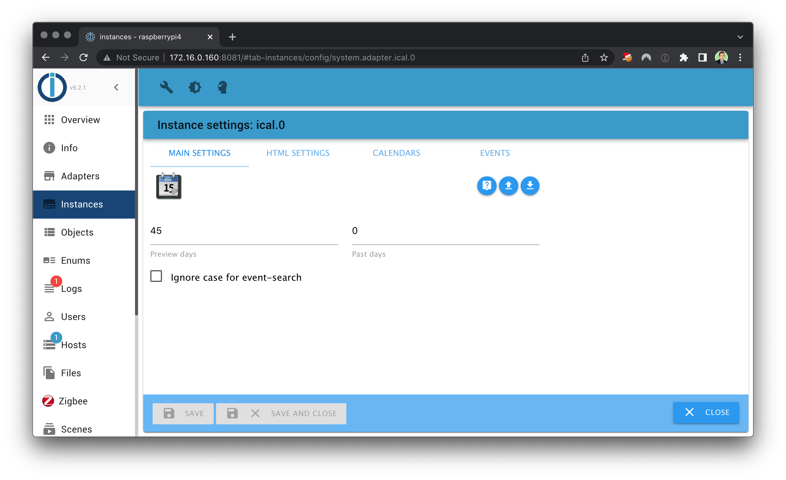
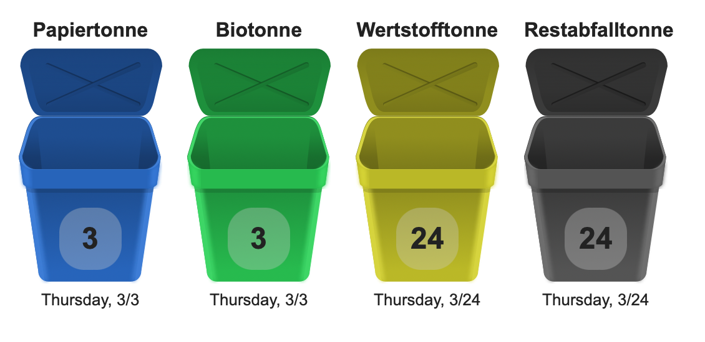

# ioBroker.trashschedule

## Table of contents

- [Providers](providers.md)
- [Blockly](blockly.md)
- [JavaScript](javascript.md)
- [FAQ](faq.md)

## Requirements

1. nodejs 20.0 (or later)
2. js-controller 6.0.0 (or later)
3. Admin Adapter 6.0.0 (or later)
4. iCal Adapter 1.12.1 (or later) - *optional*

## Configuration

1. Create a ```trashschedule``` instance and choose the ical instance as source. Alternatively, providers can be selected directly, which are integrated through various online services.
2. Go to the trash types tab and add as many types as you have trash types
3. Define a name for each new trash type and configure the matching events
4. Start the instance

**Questions?** Check the [FAQ](./faq.md)





## Preconditions for iCal

1. Create a new instance of the [ical adapter](https://github.com/iobroker-community-adapters/ioBroker.ical)
2. Configure the url of your calendar (e.g. google calendar)
3. Set "Preview days" to a range which includes every trash type at least twice (e.g. 45 days)
4. If you use the "events" tab, ensure to enable the "display" checkbox for each event type which should also be used in your trash schedule (otherwise the event will be hidden by the ical instance)



## VIS Widget (VIS version 1.x)



vis-2 has a native widget that looks the same and keeps the settings of vis-2 projects that used the vis-1 widget.

## Web component (vis-2, devices, Aura)

The next pickups are also available as the web component `iob-trashschedule-pickups` ("Trash pickup", `common.webComponents`). vis-2 offers it as a widget, devices as a tile and Aura as a widget; every other host of `@iobroker/web-components` can show it as well. It reads `trashschedule.<n>.type.json` (or the `json` state of one trash type) and shows the trash types that are not completed yet - the same can in the color of the trash type as the VIS widgets, with the days left, the name and the date of the pickup. It follows the light or dark theme of its host, fills the box it gets and writes nothing.

Settings:

- **Instance** - the instance of the adapter
- **Trash type** - optional: only this trash type (`trashschedule.0.type.<name>`); empty: all trash types
- **Layout** - trash cans (arranged to fill the box) or a list
- **Limit** - how many trash types at most (0: all)
- **Show name**, **Show date**, **Weekday** (hidden, long, short), **Date format** (system language, German, English (US))
- **Glow when due** and **Days (glow)** - the days left glow with this number of days left or fewer
